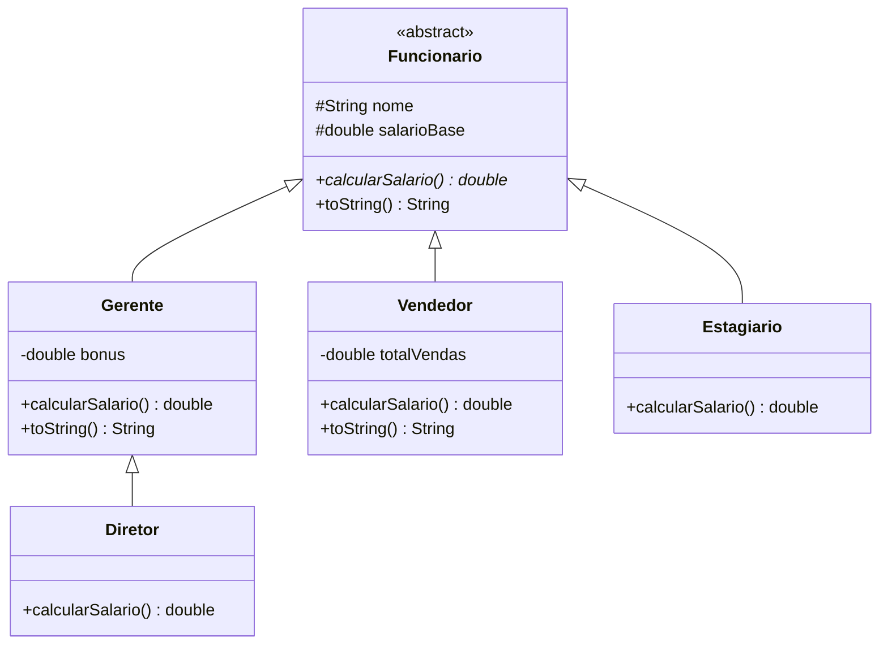

# 💼 Folha de Pagamento em Java: Herança e Polimorfismo

Projeto de estudo da disciplina de **Orientação a Objetos**, que calcula o salário de diferentes tipos de funcionários usando **herança**, **classes abstratas** e **polimorfismo de métodos**.

## 📖 Sobre o projeto

Todo funcionário tem **nome** e **salário base**, mas cada tipo calcula o salário final de um jeito diferente:

| Classe | Regra do salário final |
|---|---|
| `Gerente` | salário base + bônus |
| `Vendedor` | salário base + 5% do total de vendas |
| `Estagiario` | salário base (sem adicional) |
| `Diretor` | salário do gerente + 10.000 de participação nos lucros |

O programa guarda todos os funcionários numa única lista e calcula a folha com **um só laço**, sem nenhum `if` para descobrir o tipo de cada um.

## 🧬 Hierarquia de classes



## 🎯 Conceitos aplicados

- **Herança** (`extends`): as subclasses reaproveitam `nome` e `salarioBase` da classe `Funcionario`.
- **Herança em cadeia**: `Diretor` herda de `Gerente`, que herda de `Funcionario`.
- **Classe abstrata**: `Funcionario` não pode ser instanciada, porque "funcionário genérico" não existe na empresa.
- **Método abstrato**: `calcularSalario()` obriga cada subclasse a implementar a sua própria regra.
- **Sobrescrita** (`@Override`): cada filha reescreve `calcularSalario()` e, quando necessário, `toString()`.
- **`super(...)`**: o construtor de cada filha chama o construtor da mãe para preencher os atributos herdados.
- **`super.metodo()`**: reaproveita o código da mãe, em `toString()` e no `calcularSalario()` do `Diretor`.
- **Polimorfismo de métodos**: no laço, `f.calcularSalario()` executa a versão do **tipo dinâmico** (o objeto real), mesmo com `f` declarado como `Funcionario` (tipo estático).
- **Encapsulamento**: atributos `protected` na mãe (visíveis às filhas) e `private` nos atributos exclusivos de cada subclasse.

## 📁 Estrutura

```
.
├── README.md
└── Empresa/
    ├── Funcionario.java
    ├── Gerente.java
    ├── Vendedor.java
    ├── Estagiario.java
    ├── Diretor.java
    └── Main.java
```

## ▶️ Como executar

É necessário ter o **JDK 11 ou superior** instalado.

```bash
# Na raiz do projeto: compilar
javac -d out Empresa/*.java

# Executar
java -cp out Empresa.Main
```

Também funciona em qualquer IDE (IntelliJ, Eclipse, VS Code): abra a pasta e execute a classe `Main`.

## 🖥️ Exemplo de saída

```
Nome: Vri, Salário base: 1000.0, Bônus: 200.0
Salário: 1200.0
Nome: Miguel, Salário base: 1621.0, Vendas: 100.0
Salário: 1626.0
Nome: Ana, Salário base: 5000.0
Salário: 5000.0
Nome: Carlos, Salário base: 3000.0, Bônus: 500.0
Salário: 13500.0
Total da folha: 21326.0
```

> Em computadores configurados em português do Brasil, o `String.format("%.1f")` pode mostrar vírgula (`1000,0`) em vez de ponto. É apenas o formato de número do idioma do sistema.

## 🔧 Extensibilidade

Para adicionar um novo tipo de funcionário, basta criar uma classe que herde de `Funcionario` (ou de `Gerente`) e implemente `calcularSalario()`. O laço do `Main` **não precisa ser alterado**, porque ele trabalha com o tipo genérico `Funcionario`.

## 👤 Autor

**Virissimo Djedjo**: [github.com/virissimo-djedjo](https://github.com/virissimo-djedjo)
